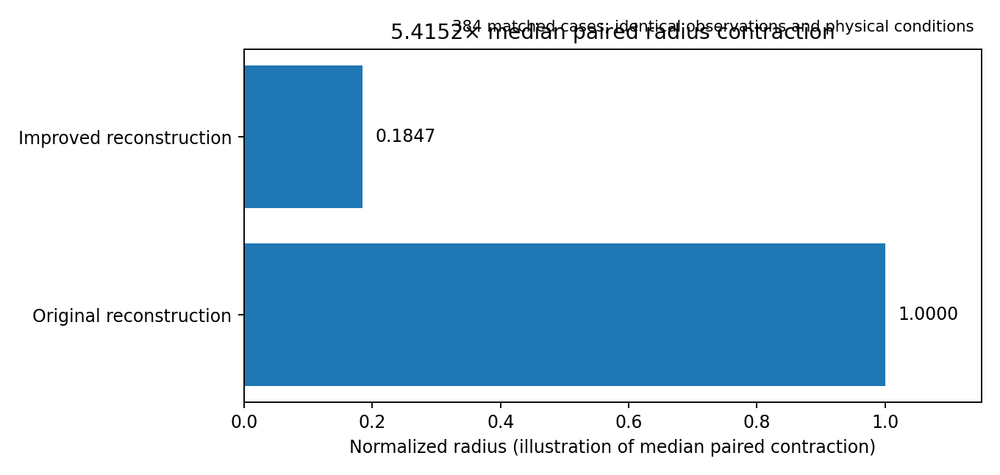
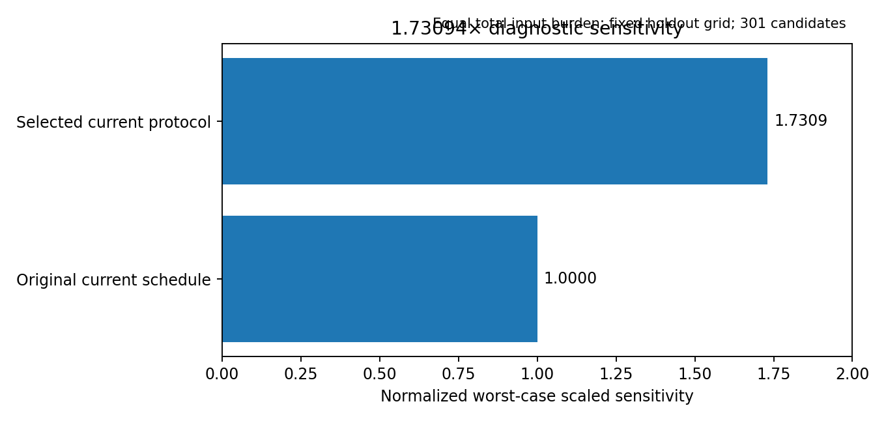
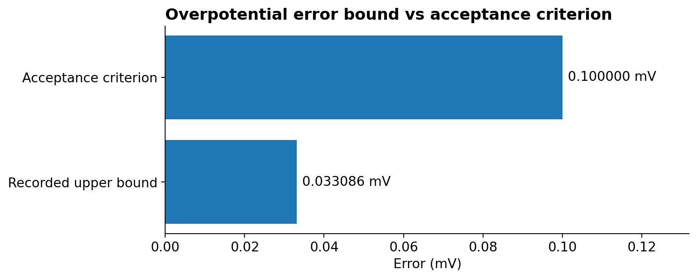
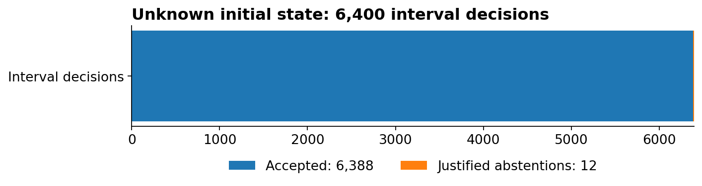
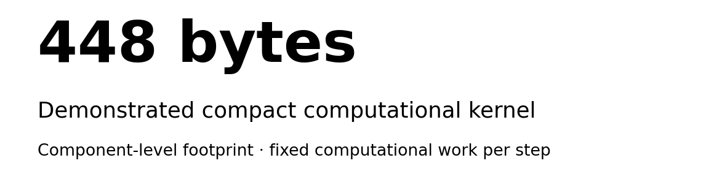
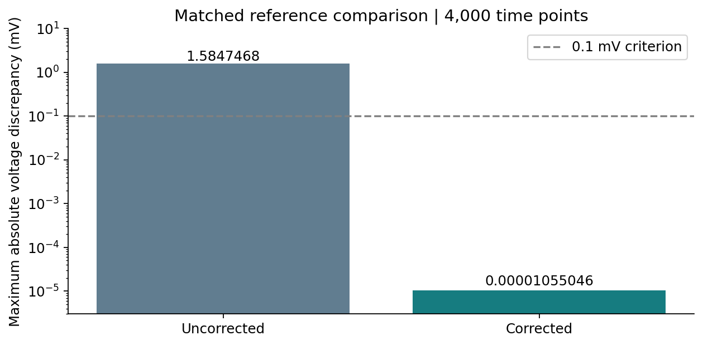
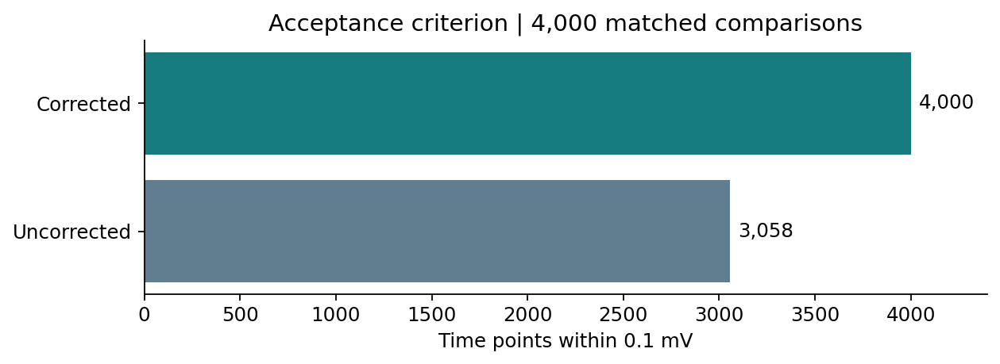
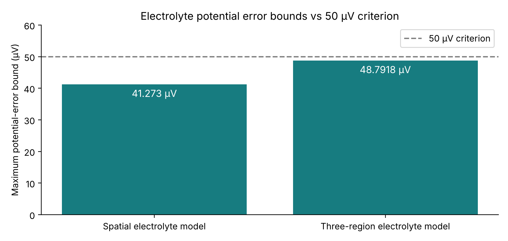
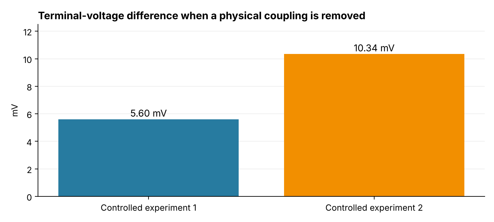
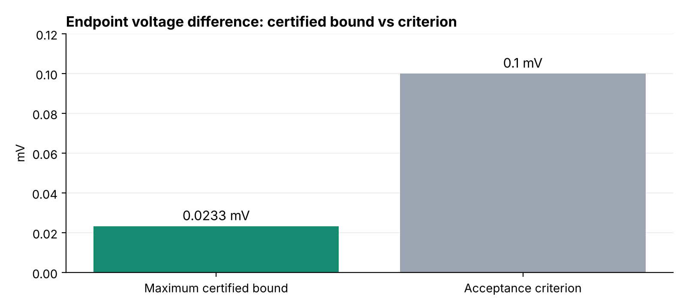

# Advanced Battery State & Error Intelligence

**Internal battery-state intelligence, electrochemical prediction and mathematically verified computational accuracy.**

**Technology licensing · Industrial integration · Strategic acquisition**

Proprietary technology for battery management systems, energy storage, fast charging, electrochemical simulation and industrial diagnostics.

## The technology

Battery State & Error Intelligence brings together internal-state estimation, electrochemical dynamics, transient analysis and numerical error assurance in a single technology portfolio.

The central engineering problem is that terminal voltage, current and temperature do not directly reveal the internal electrochemical state of a battery. A reliable decision requires understanding both the possible internal states and the accuracy of the computation used to estimate them.

The technology addresses both requirements: it determines admissible internal states, tracks their evolution and establishes quantitative bounds on computational error. It turns battery-model uncertainty into actionable engineering information.

## Established capabilities

| Technology | Industrial value |
|---|---|
| Fast-charging protection | Evaluate internal electrochemical constraints associated with lithium plating and electrolyte depletion; support charge-current decisions. |
| Internal-state estimation | Determine admissible internal states from electrical observations and operating history. |
| Voltage and state forecasting | Account for polarization memory, pulses, relaxation and current reversals. |
| Electrochemical digital twin | Compute coupled electrode, electrolyte and reaction dynamics. |
| Numerical error assurance | Quantify the accuracy of reduced-order models and identify where their outputs cease to satisfy a specified tolerance. |
| Transient verification | Establish mathematical bounds on dynamic behavior, including between sampled time points in certified scenarios. |
| Rapid diagnostics | Use designed electrical excitation to improve internal-state observability and shorten diagnostic procedures. |
| Embedded battery intelligence | Bring compact computational components into BMS firmware and industrial control architectures. |

## Core technological innovations

The distinguishing asset is a computational technology that addresses **both the battery state and the reliability of the calculation used to determine it**.

- **State uncertainty becomes a quantified engineering output.** Instead of collapsing ambiguous observations into a single estimate, the technology identifies admissible internal states and determines when the available information supports a decision.
- **Accuracy becomes an explicit acceptance criterion.** Reduced-order computations are qualified against defined error limits; a result outside the supported domain is not presented as verified.
- **Transient behavior becomes verifiable.** Certified intervals address behavior between sampling points, where endpoint agreement alone does not establish continuous-time accuracy.
- **Operating history becomes part of state intelligence.** Polarization memory, relaxation and current reversals are incorporated into prediction and diagnostics.
- **Observability becomes an engineering design variable.** Electrical excitation is evaluated for its ability to distinguish hidden states, with a recorded 5.4152× contraction in median admissible-state radius and 1.73094× improvement in sensitivity in the respective experiments.
- **Compact computation and mathematical assurance are combined.** The portfolio includes an embedded-scale kernel as well as detailed electrochemical verification capabilities.

## Technology differentiation

The commercial opportunity is an independent layer of battery-state intelligence and computational assurance that can be integrated into existing industrial products.

| Existing technology category | Established industry focus | Our distinct contribution |
|---|---|---|
| Battery management and state estimation | Operational control and state indicators | Admissible internal-state ranges, observability assessment and explicit result qualification |
| Fleet and BESS analytics | Monitoring, degradation forecasts and asset performance | Independent evaluation of internal-state uncertainty and numerical model reliability |
| Electrochemical simulation | Detailed physical predictions and engineering analysis | Quantitative error bounds, reduced-model qualification and verified dynamic transitions |
| Adaptive charging | Charging strategy and operating-limit management | Evaluation of internal electrochemical constraints alongside explicit computational acceptance criteria |
| Embedded battery computation | Resource-efficient estimation and control | Compact computational components combined with a portfolio of mathematical verification capabilities |

The advantage is demonstrated through the recorded metrics below: state-set contraction, sensitivity improvement, error bounds and interval verification. These measure the specific technical capabilities offered, rather than claiming a head-to-head advantage on unrelated market metrics.

Public market context: [ACCURE — battery analytics](https://www.accure.net/battery-analytics/battery-intelligence), [TWAICE — BESS simulation](https://www.twaice.com/products/energy-storage-analytics/simulation-models-bess), [TWAICE — anode potential modeling](https://www.twaice.com/lp/anode-potential-battery-simulation-model), [PyBaMM — battery simulation](https://pybamm.org/about/).

## Quantitative results

**5.4152× tighter median admissible-state radius · 1.73094× sensitivity improvement · 67,242 electrolyte comparisons · 113 consecutive certified endpoints.**

The completed computational program includes hundreds of thousands of numerical comparisons, mathematical error bounds, interval certificates and negative tests.

| Result | Recorded evidence |
|---|---:|
| Unknown initial-state interval decisions | 6,388 accepted / 6,400; 12 justified abstentions |
| Median admissible-state radius contraction | 5.4152× across 384 paired cases |
| Diagnostic sensitivity improvement | 1.73094× across a study of 301 current protocols |
| Overpotential error upper bound | 0.033086 mV against a 0.1 mV criterion |
| Electrolyte error upper bounds (two separate models) | 41.273 µV and 48.7918 µV |
| Coupled electrochemical model checks | 27/27 primary and 4/4 additional checks |
| Corrected dynamic forecast discrepancy | 0.0000105505 mV maximum across 4,000 comparisons with a separately computed 384-mode model |
| Sequential interval verification | 113 consecutive endpoints over 11.3 s; branch-difference upper bound 0.0232959146 mV |
| Compact particle-model comparisons | 148,640 |
| Certified time intervals | 18,580 |
| Unknown-initial-history comparisons | 38,400 |
| Electrolyte-model comparisons | 67,242 |
| Voltage observations in observability experiments | 35,328 |
| Joint state and polarization-memory estimation | 384 / 384 cases retained the true model parameters |
| Forecast classification | 576 forecasts across 36 protocols |

The results demonstrate three distinct capabilities: narrowing uncertainty about internal states, controlling numerical error and verifying dynamic trajectories. Each numerical bound refers to its documented model, test conditions and comparison quantity.

**Scope of results:** results are obtained on models; physical-cell testing is performed during integration.

## Visual evidence

Recorded computational results, presented without proprietary implementation details. The comparisons below use matched internal computational experiments, not competing commercial products.

### Internal-state observability

Across 384 matched computational cases using identical synthetic voltage observations and physical conditions, every case improved relative to the original reconstruction configuration. The contraction factors ranged from **1.9333× to 26.9048×**, with a median of **5.4152×**.

### Diagnostic sensitivity

The selected current protocol improved worst-case scaled sensitivity by **1.73094×** relative to the original current schedule with the same total input burden, evaluated on a fixed holdout grid. The selection study covered 301 candidate protocols.

### Overpotential error assurance

### Qualified interval decisions

### Embedded computation

## Additional demonstrated performance

| Capability | Recorded result | Industrial significance |
|---|---|---|
| State containment | 9,600/9,600 quasistatic cases (including 3,840 holdout cases); 1,472/1,472 separate dynamic cases | Reference synthetic states retained within computed admissible sets |
| Strict state resolution | 1,724 quasistatic cases met the strict radius criterion | Quantified resolution of internal-state estimates |
| Dynamic state reconstruction | All 384 matched cases improved; 1.9333×–26.9048× contraction | Consistent improvement across the evaluated cohort |
| Electrolyte potential accuracy | 41.273 and 48.7918 µV upper bounds in separate studies, both below the 50 µV criterion | Quantitative model qualification |
| Physical coupling | 5.60 and 10.34 mV terminal-voltage differences in two controlled coupling-removal experiments | Identifies the consequences of omitted physical interactions |
| Coupled reaction verification | 22/22 checks across 17 profiles and 3,400 steps | Evidence for coupled-model consistency |
| Dynamic error correction | 150,206.39× ratio of maximum discrepancies before and after correction across the same 4,000 comparisons | Quantified improvement against a separately computed numerical reference |
| Dynamic tolerance compliance | 3,058/4,000 before correction; 4,000/4,000 after correction at 0.1 mV | Direct evidence of improved numerical tolerance compliance |
| Sequential verification | 536 local interval enclosures, 452 nonlinear root certificates; 113 consecutive endpoints over 11.3 seconds with 16 current reversals | Numerical evidence for demanding dynamic operation |

### Dynamic prediction: quantified error reduction

Across 20 matched trajectories and 4,000 timewise comparisons against a separately computed 384-mode reference, the maximum absolute voltage discrepancy decreased from **1.5847467902 mV to 0.000010550462 mV**. The ratio of these cohort maxima is **150,206.39×**. The corrected maximum is a computational discrepancy relative to the reference model, not physical sensor accuracy.

The correction accounts for accumulated voltage-prediction error introduced by reduced-order electrochemical modeling over the operating history, including current reversals.

### Electrolyte accuracy and physical coupling

### Sequential dynamic verification

## What makes this technology commercially valuable

**Internal-state intelligence.** A battery-management decision can incorporate admissible internal electrochemical states rather than relying exclusively on a single estimated state-of-charge value.

**Quantified accuracy.** Computational outputs can be accompanied by explicit error bounds and acceptance criteria. The system can distinguish a verified result from one that requires additional information or computation.

**Dynamic operation.** Current changes, relaxation and accumulated operating history are treated as integral parts of the battery state. This is directly relevant to fast charging, variable industrial loads and energy-storage dispatch.

**Independent model assurance.** Battery manufacturers and engineering teams can evaluate reduced-order models against detailed physical models and determine where a specified accuracy requirement is satisfied.

## Industrial value for energy storage and battery operations

For utility-scale storage and industrial battery assets, the portfolio provides an independent computational layer for assessing operating-state uncertainty, qualifying model-based decisions and examining the effects of dispatch history, load changes and relaxation.

For charging and BMS engineering, the technology supports evaluation of two critical electrochemical constraints: lithium concentration at the anode particle surface and electrolyte depletion. A control decision can distinguish a verified admissible operating condition from a condition requiring current limitation or further assessment.

For battery diagnostics, a documented pulse-test protocol of approximately three minutes demonstrates internal-state assessment within the tested model. This provides a concrete route toward shorter diagnostic procedures for manufacturing, service and second-life evaluation.

For embedded engineering, a compact computational kernel has been demonstrated with a 448-byte footprint and fixed computational work per step. This is a component-level result, not a memory specification for the entire portfolio.

## Industrial applications

- **Battery energy storage systems (BESS):** operating-state diagnostics, model assurance and charge/discharge decision support.
- **Battery and cell manufacturers:** electrochemical model qualification, diagnostic protocols and engineering validation.
- **Electric vehicles and charging infrastructure:** fast-charging control, transient-state estimation and BMS integration.
- **Industrial energy systems:** battery monitoring under variable loads, operational diagnostics and computational assurance.
- **Battery testing and second-life applications:** internal-state assessment and diagnostic protocol optimization.
- **Engineering software and BMS suppliers:** integration of proprietary computational and verification capabilities into existing products.

## Economic value for energy storage operators

The technology targets measurable commercial outcomes across the battery asset lifecycle.

| Business priority | Technology contribution | Evaluation metric |
|---|---|---|
| Asset availability | Qualify state estimates used in operating decisions | Avoidable downtime and unnecessary derating |
| Dispatch economics | Assess state uncertainty under changing load histories | Usable energy and dispatch deviations |
| Operating risk | Evaluate internal electrochemical limits and transient behavior | Unsupported operating decisions and constraint violations |
| Commissioning and procurement | Independently assess model accuracy against defined tolerances | Verification time and acceptance-test coverage |
| Maintenance and diagnostics | Apply informative electrical test profiles | Diagnostic duration and state uncertainty |
| Engineering cost | Qualify compact models before integration | Model-validation effort and computational resource requirements |
| Second-life assessment | Support internal-state discrimination | Diagnostic throughput and classification uncertainty |

These are commercial evaluation targets, not claimed field savings. A buyer can select a use case, define its acceptance criteria and evaluate the corresponding technology against its existing workflow.

## Licensable technology portfolio

| Commercial asset | Licensable capability | Target buyer |
|---|---|---|
| Fast-Charging Constraint Guard | Internal electrochemical limit assessment | Charging technology and BMS teams |
| Internal-State Observer | Admissible-state reconstruction and observability | BESS, cell manufacturers and OEMs |
| Voltage & State Forecaster | History-aware dynamic prediction | BMS and energy-system developers |
| Electrochemical Digital Twin Core | Coupled internal electrochemical computation | Cell manufacturers and engineering software providers |
| Battery Error Assurance Engine | Error qualification and independent model verification | OEMs, engineering teams and validation laboratories |
| Transient Verification Engine | Interval-based dynamic result qualification | Safety engineering and industrial control teams |
| Rapid Diagnostics Technology | Informative excitation and state discrimination | Manufacturing, service and second-life operators |
| Embedded Battery Intelligence Kernel | Compact computation for integration | Firmware and embedded-system developers |

Commercial structures include individual module licenses, portfolio licensing, customer-specific integration, paid technical verification and strategic IP acquisition. License scope and delivery format are agreed for the selected capability; the buyer does not need to acquire the entire portfolio.

## Commercial availability

The technology is available for commercial discussions covering:

- Licensing of individual computational modules or the complete technology portfolio.
- OEM and BMS integration.
- Independent battery-model verification and technical audits.
- Customer-specific adaptation to cell models, operating profiles and engineering requirements.
- Strategic licensing and technology acquisition.

Select a capability and operating scenario. The corresponding computational technology can be demonstrated against agreed inputs and measurable acceptance criteria, followed by a licensing, integration or acquisition discussion. The commercial asset is the existing technology and its documented results, rather than a proposal to begin developing the underlying mathematics.

## Technical evidence and intellectual property

The technology portfolio is supported by documented mathematical results, numerical experiments, regression checks and interval-verification records. Supporting evidence can be reviewed within an agreed technical evaluation process.

This repository is the public technology overview. The proprietary implementation, internal mathematical methods, source code and detailed computational configurations remain protected. No open-source license is granted for the underlying technology.

## Contact

**cxclrfx** — Technology owner and independent developer.

Commercial licensing, industrial integration and strategic acquisition inquiries: contact the repository owner through GitHub.
